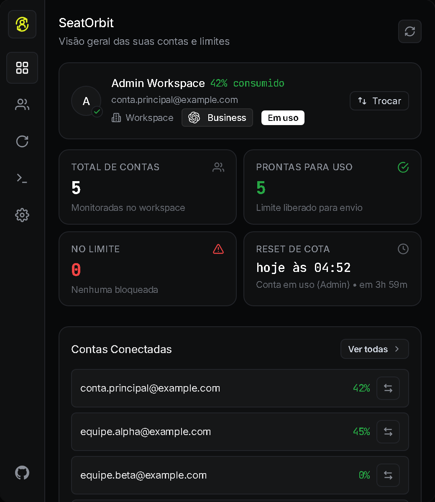
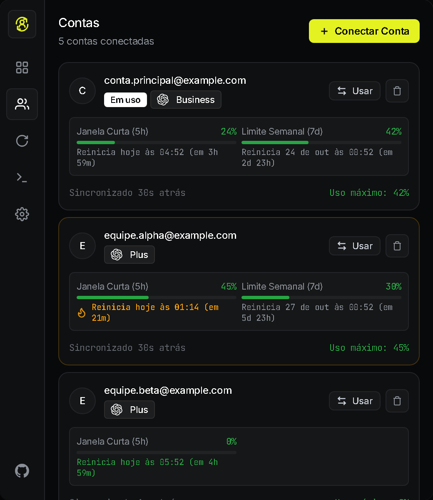
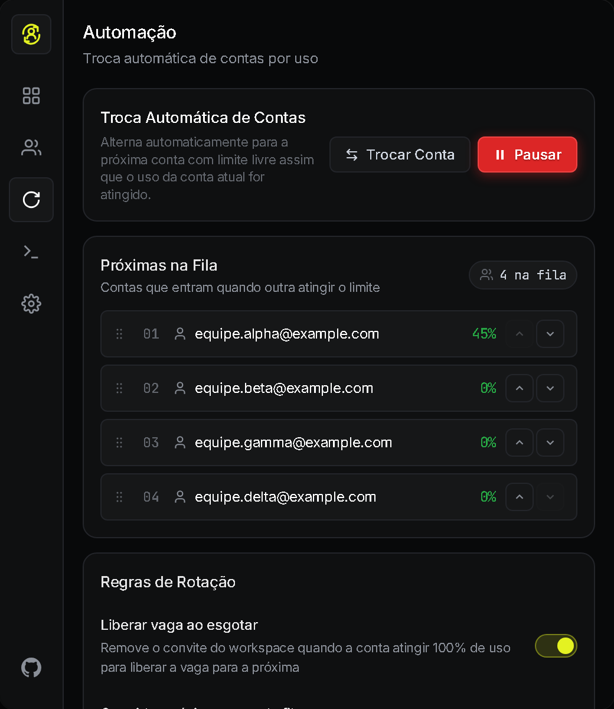
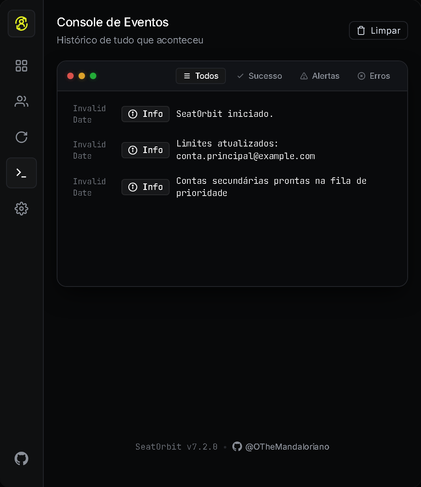
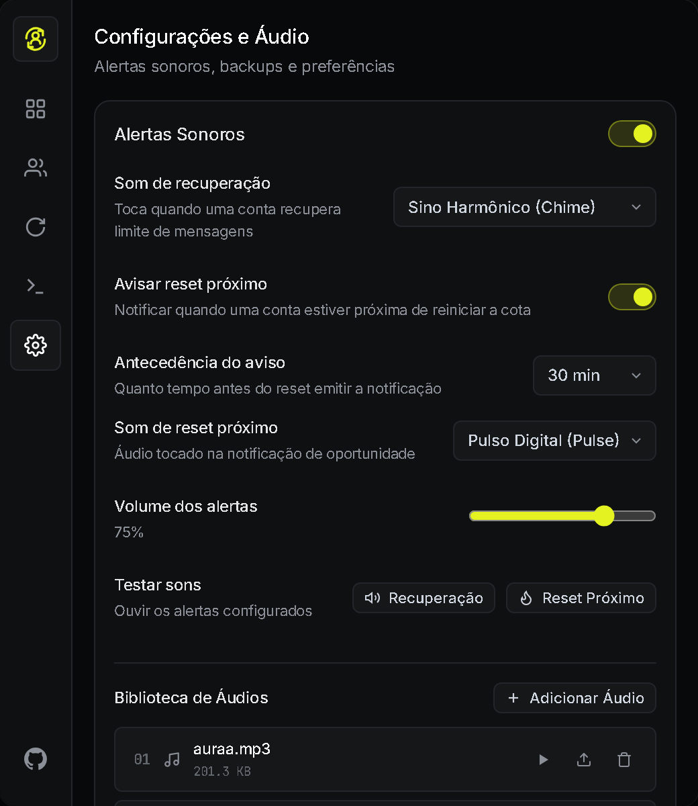
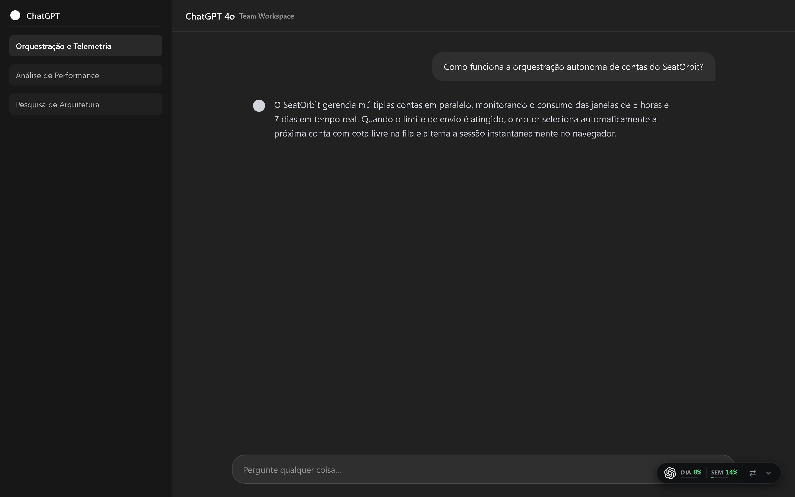

# SeatOrbit

<div align="center">


### Alternância inteligente de sessões, telemetria de cotas e rotação autônoma para ChatGPT Workspace, Team e contas pessoais no Google Chrome.

[](https://developer.mozilla.org/pt-BR/docs/Web/JavaScript)
[](https://developer.chrome.com/docs/extensions/mv3/intro/)
[](https://developer.mozilla.org/pt-BR/docs/Web/API/Web_Audio_API)
[](https://developer.chrome.com/docs/extensions/reference/api/storage)

[](CHANGELOG.md)
[](LICENSE)
[](https://github.com/OTheMandaloriano/seatorbit/releases)
[](https://github.com/OTheMandaloriano)

</div>

---

##  &nbsp;O que é o SeatOrbit

O **SeatOrbit** é uma extensão de navegador desenvolvida sob a especificação Manifest V3 para gerenciar múltiplos assentos e perfis de conta no ChatGPT.

Profissionais e equipes que utilizam o ChatGPT em alta frequência enfrentam interrupções constantes por limite de mensagens (rate limits). O SeatOrbit resolve este problema mantendo múltiplas contas autenticadas em paralelo, monitorando a taxa de consumo de cada janela operacional e alternando para o próximo assento livre de forma imediata ou totalmente autônoma.

> [!NOTE]
> Todo o processamento, armazenamento de tokens de sessão e cálculo de cotas ocorrem estritamente dentro da sandbox do navegador local. Nenhum dado transita por servidores intermediários.

---

##  &nbsp;Interface & Demonstração Visual

A interface do **SeatOrbit** foi construída sob os preceitos do design system **Midnight Precision Instrument**, combinando a estética de alta densidade do *Linear* com a fluidez do *Apple Fluid Motion*. Zero adornos supérfluos, tipografia mono cirúrgica e tema dark nativo projetado para ergonomia visual prolongada.

<div align="center">

### Visão Geral & Telemetria em Tempo Real

<p><em>Bento grid com status da conta em uso no navegador, métricas 2x2 com respiração óptica e lista resumida de contas conectadas.</em></p>

<br>

| Gerenciador de Contas & Cotas | Piloto Automático & Rotação |
| :---: | :---: |
|  |  |
| **Janelas Operacionais Dual (5h / 7d)**<br><em>Acompanhamento individual por modelo, status de reset e alternância de sessão em 1 clique.</em> | **Fila Dinâmica de Prioridades**<br><em>Reordenação visual, motor de auto-rotação e políticas de liberação inteligente de assentos.</em> |

<br>

| Terminal de Auditoria | Preferências & Áudio Nativo |
| :---: | :---: |
|  |  |
| **Auditoria e Logs de Sistema**<br><em>Rastreamento em tempo real de trocas de conta, validações de cookie e renovações de ciclo.</em> | **Sintetizador Web Audio API**<br><em>Presets sonoros discretos (Chime, Pulse, Bell), volume ajustável e backup de dados.</em> |

<br>

### HUD Flutuante no ChatGPT (In-Page Native Dock)

<p><em>Dock minimalista injetado no DOM do ChatGPT (chatgpt.com) com telemetria de cota e troca imediata de conta sem sair da conversa.</em></p>

</div>

---

##  &nbsp;Recursos Principais

| Recurso | Descrição Técnica | Benefício Operacional |
| :--- | :--- | :--- |
| **Alternância sem Logout** | Manipulação direta de fragmentos da sessão (`__Secure-next-auth.session-token`) via API `chrome.cookies` | Troca de conta em menos de 300ms sem redigitar senhas ou passar por fluxos de login |
| **Monitoramento Dual de Janelas** | Telemetria contínua das janelas operacionais de 5 horas (curto prazo) e 7 dias (acumulado do plano) | Visibilidade exata do consumo de cada assento antes do bloqueio |
| **Piloto Automático de Rotação** | Algoritmo de fila prioritária que seleciona a conta com maior cota disponível quando a atual atinge o limite | Produtividade contínua durante sessões longas de pesquisa e geração de código |
| **HUD Flutuante no ChatGPT** | Componente injetado diretamente no DOM da página com baixo acoplamento | Permite trocar de assento sem abrir a janela de popup da extensão |
| **Avisos de Reset com Barra Regressiva** | Notificações visuais acionadas quando uma conta ociosa está prestes a renovar a cota | Aproveitamento máximo de mensagens antes do zeramento cíclico |
| **Sintetizador Sonoro em Offscreen** | Motor de áudio nativo construído com Web Audio API desacoplado do Service Worker | Notificações audíveis discretas sem necessidade de arquivos externos pesados |

---

##  &nbsp;Arquitetura do Sistema

A extensão foi projetada respeitando as restrições de ciclo de vida impostas pelo Manifest V3 do Chromium:

```
┌────────────────────────────────────────────────────────┐
│                   SeatOrbit Runtime                    │
├───────────────────┬───────────────────┬────────────────┤
│  Service Worker   │   Offscreen DOM   │  Content Script│
│  (background.js)  │  (offscreen.js)   │  (content.js)  │
│                   │                   │                │
│ • Orquestração    │ • Web Audio API   │ • HUD Flutuante│
│ • Gestão Cookies  │ • Amostras WAV    │ • Leitura DOM  │
│ • Rotação Fila    │ • Decodificação   │ • Feedback UI  │
│ • Polling Cotas   │                   │                │
└─────────┬─────────┴─────────┬─────────┴────────┬───────┘
          │                   │                  │
          └───────────────────┼──────────────────┘
                              │
                    ┌─────────▼─────────┐
                    │     Popup SPA     │
                    │ (HTML / CSS / JS) │
                    │                   │
                    │ • Painel Central  │
                    │ • Lista de Contas │
                    │ • Automação       │
                    │ • Configurações   │
                    └───────────────────┘
```

<details>
<summary><b>Detalhes sobre o ciclo de vida e áudio em segundo plano</b></summary>

<br>

O Google Chrome Manifest V3 encerra workers inativos após 30 segundos e proíbe a execução direta do `AudioContext` dentro do Service Worker.

Para permitir feedback sonoro confiável sem manter processos fantasmas ativos, o SeatOrbit cria e destrói dinamicamente um contexto `chrome.offscreen` apenas no instante do disparo acústico. Assim que a reprodução encerra, o documento offscreen é finalizado, reduzindo o consumo de memória a zero bytes adicionais em repouso.

</details>

---

##  &nbsp;Limitações Conhecidas

A tabela abaixo descreve o estado real das limitações do sistema e a justificativa técnica de cada uma:

| Limitação | Impacto | Motivo Técnico |
| :--- | :--- | :--- |
| **Primeiro Login Manual** | Cada conta adicionada precisa ser logada pelo menos uma vez no navegador | O sistema respeita as camadas anti-bot da Cloudflare e o fluxo OAuth oficial, sem interceptar senhas em texto puro |
| **Injeção Restrita ao Domínio** | O HUD flutuante só aparece nas páginas sob o padrão `https://chatgpt.com/*` | Aplicação estrita do princípio de menor privilégio no `manifest.json`, impedindo execução de scripts fora da área de trabalho |
| **Sessões Simultâneas no Mesmo Perfil** | Duas abas do ChatGPT abertas ao mesmo tempo no mesmo navegador compartilham a conta ativa atual | O Chromium mantém um único repositório de cookies de sessão por perfil de usuário, exigindo reload suave da aba ao rotacionar |
| **Limite de Armazenamento de Áudios** | Áudios personalizados enviados pelo usuário são limitados a amostras de até 2 MB | Preservação da cota de armazenamento local `chrome.storage.local` e garantia de latência zero na decodificação Base64 |

---

##  &nbsp;Instalação e Execução

### Opção 1: Pacote Oficial Pré-compilado (Recomendado)

1. Baixe o pacote oficial compactado na página de [Releases](https://github.com/OTheMandaloriano/seatorbit/releases).
2. Descompacte o arquivo `seatorbit-v7.2.0.zip` em uma pasta de sua escolha.
3. No Google Chrome, Brave ou Microsoft Edge, acesse:
   ```
   chrome://extensions/
   ```
4. Ative a chave **Modo do desenvolvedor** no canto superior direito.
5. Clique no botão **Carregar sem compactação** (Load unpacked).
6. Selecione a pasta descompactada onde reside o arquivo `manifest.json`.

> [!TIP]
> Fixe o ícone do SeatOrbit na barra de ferramentas do seu navegador para visualizar alertas de status e alternar contas com um clique.

### Opção 2: A partir do Repositório Git

```bash
# Clone o repositório
git clone https://github.com/OTheMandaloriano/seatorbit.git

# Acesse o diretório
cd seatorbit

# Carregue a pasta diretamente no painel chrome://extensions
```

---

##  &nbsp;Modo de Uso

1. **Vincular a Primeira Conta:**
   - Faça login na sua conta principal no [ChatGPT](https://chatgpt.com).
   - Abra a janela do SeatOrbit e clique em **Conectar Conta**. O token da sessão é capturado automaticamente.
2. **Adicionar Contas Secundárias:**
   - Na aba **Contas**, clique em **Conectar Conta**.
   - Conclua o login na janela de suporte aberta pelo assistente. A nova conta será registrada no painel.
3. **Alternância Manual:**
   - Clique em **Usar** na lista de contas ou use o menu do HUD no canto inferior da página do ChatGPT.
4. **Ativação da Rotação Autônoma:**
   - Acesse a aba **Automação** e ative o botão de rotação.
   - Quando o limite de mensagens for disparado, o SeatOrbit substitui a sessão pela conta seguinte da lista de prioridade.

> [!IMPORTANT]
> A rotação autônoma requer que ao menos duas contas estejam cadastradas e com sessões ativas no cofre local.

---

##  &nbsp;Atalhos de Teclado

| Combinação de Teclas | Ação Executada |
| :--- | :--- |
| `Alt + Shift + S` | Abre o painel principal do SeatOrbit no navegador |
| `Alt + Shift + R` | Força a rotação imediata para a próxima conta com cota disponível |

---

##  &nbsp;Segurança e Privacidade

- **Cofre 100% Local:** Tokens e cookies de sessão permanecem restritos ao armazenamento do próprio navegador (`chrome.storage.local`).
- **Sem Rastreamento:** O código-fonte não possui rastreadores, analytics, bibliotecas de terceiros ou chamadas de telemetria externa.
- **Transparência de Código:** Todo o ecossistema é construído em JavaScript puro, auditável diretamente inspecionando os arquivos do repositório.

---

##  &nbsp;Estrutura de Arquivos

```
seatorbit/
├── manifest.json              # Manifesto oficial Manifest V3
├── README.md                  # Documentação principal
├── CHANGELOG.md               # Histórico formal de versões
├── LICENSE                    # Termos de licença MIT
├── assets/
│   ├── icons/                 # Identidade visual da extensão
│   └── sounds/                # Amostras de áudio padrão
└── src/
    ├── background/            # Ciclo de vida, cookies e rotação autônoma
    │   └── background.js
    ├── content/               # HUD flutuante injetado no chatgpt.com
    │   └── content.js
    ├── offscreen/             # Processamento de áudio desacoplado
    │   ├── offscreen.html
    │   └── offscreen.js
    └── popup/                 # Interface de usuário principal
        ├── popup.html
        ├── popup.css
        └── popup.js
```

---

##  &nbsp;Contribuindo

Contribuições da comunidade são bem-vindas para manter o SeatOrbit compatível com as constantes atualizações de interface e segurança do ChatGPT.

Antes de abrir uma solicitação:

1. **Relato de Falhas:** Certifique-se de que o comportamento indesejado pode ser reproduzido com outras extensões desativadas. Descreva o cenário passo a passo na aba de [Issues](https://github.com/OTheMandaloriano/seatorbit/issues).
2. **Sugestões de Recursos:** Proponha novas ideias detalhando o caso de uso prático e o impacto na rotina de trabalho.
3. **Segurança e Privacidade:** Nunca compartilhe capturas de tela contendo endereços de e-mail reais, tokens de sessão ou dados confidenciais de trabalho.
4. **Pull Requests:** Mantenha alterações focadas, atômicas e testadas no modo descompactado do navegador.

---

##  &nbsp;Autoria e Mantenedor

O projeto é desenvolvido e mantido por:

<table>
  <tr>
    <td align="center" width="110">
      <a href="https://github.com/OTheMandaloriano">
        
      </a>
    </td>
    <td>
      <strong>OTheMandaloriano</strong><br />
      <em>Criador e Mantenedor Principal do SeatOrbit</em><br />
      <br />
      <a href="https://github.com/OTheMandaloriano">
        
      </a>
      &nbsp;
      <a href="https://github.com/OTheMandaloriano/seatorbit/issues">
        
      </a>
      &nbsp;
      <a href="https://github.com/OTheMandaloriano/seatorbit/releases">
        
      </a>
    </td>
  </tr>
</table>

---

##  &nbsp;Licença

Este projeto é disponibilizado sob os termos da **Licença MIT**. Para obter informações detalhadas sobre direitos de uso, modificação e distribuição, consulte o arquivo [LICENSE](LICENSE).

